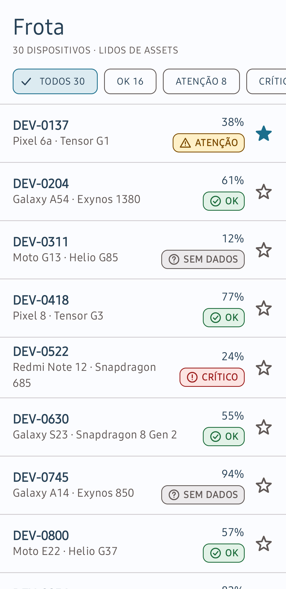
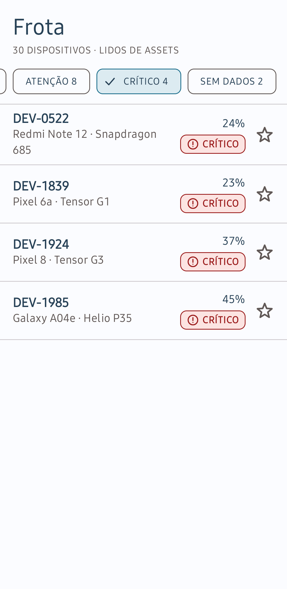
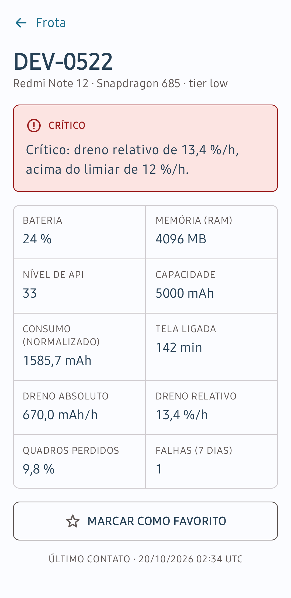
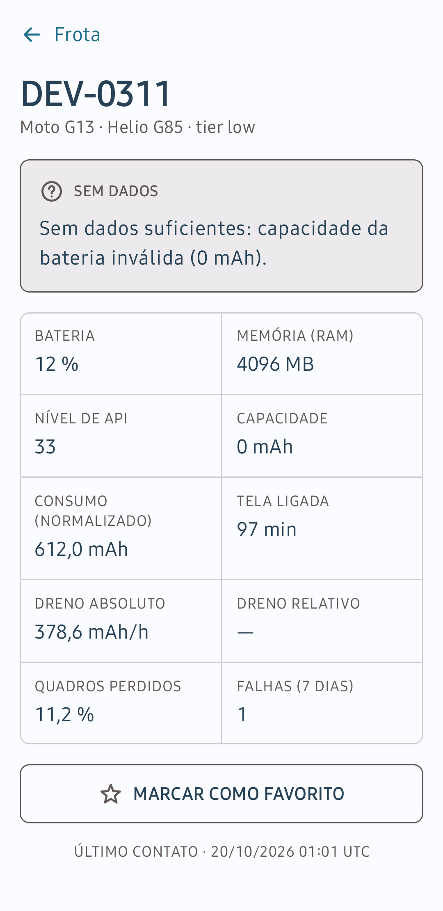

# Desafio Técnico - Seldon Fleet

[](https://github.com/celiobenj/desafio-seldon/actions/workflows/ci.yml)

Enunciado do desafio: https://maktheus.github.io/seldon-chalange/

App Android em Kotlin e Jetpack Compose que lê `assets/frota.json`, classifica cada dispositivo da frota e mostra o motivo da classificação. Funciona sem rede. A regra de classificação fica na camada de domínio, em Kotlin puro, e roda nos testes da JVM.

A regra, o tratamento dos dois defeitos do arquivo e as ameaças à validade estão no [PROTOCOLO.md](PROTOCOLO.md).

## Capturas

| Lista | Lista filtrada por CRITICO |
|---|---|
|  |  |

| Detalhe de DEV-0522 (CRITICO) | Detalhe de DEV-0311 (INDETERMINADO) |
|---|---|
|  |  |

## Como executar

Pré-requisitos:

- Android Studio com o Android SDK Platform 37 (`compileSdk` 37, `minSdk` 26).
- JDK 17. O Gradle usa o JDK definido em `gradle/gradle-daemon-jvm.properties` e baixa um se não encontrar.
- `local.properties` com `sdk.dir`, ou a variável `ANDROID_HOME`. O Android Studio cria o arquivo ao abrir o projeto.

```bash
git clone https://github.com/celiobenj/desafio-seldon.git
cd desafio-seldon
./gradlew test            # testes na JVM, sem emulador
./gradlew :app:detekt     # análise estática
./gradlew installDebug    # instala no aparelho ou no emulador conectado
```

Para rodar num aparelho, ative a depuração USB e confira se ele aparece em `adb devices`. Para usar o emulador, crie um dispositivo no Device Manager do Android Studio (API 26 ou superior) e inicie-o antes do `installDebug`, ou use o botão Run.

## Arquitetura

```
ui/                          data/
Compose, ViewModel           JSON, DataStore, assets
      │                            │
      └──────────┐   ┌─────────────┘
                 ▼   ▼
               domain/
   Device · DeviceStatus · ClassifyDevice · interfaces
   Kotlin puro: sem Android, sem JSON, sem arquivos
```

- `ui` e `data` dependem de `domain`; `domain` não depende de nenhuma das duas.
- `domain` declara `DeviceRepository` e `FavoritesRepository`, e `data` implementa as duas (`FleetRepositoryImpl` e `DataStoreFavoritesRepository`). Nos testes da interface, repositórios em memória ocupam o lugar delas sem nenhuma mudança em `domain`.
- `AppContainer`, criado pela `Application`, monta as dependências. Os ViewModels recebem `ClassifyDevice` e os repositórios pelo construtor.
- Cada tela tem um ViewModel que expõe o estado num `StateFlow`. Os Composables só desenham esse estado; a classificação acontece no ViewModel, nunca na tela nem no parser.
- O `DeviceMapper` converte mWh para mAh, e o domínio recebe a energia já em mAh.

Duas verificações no CI protegem a fronteira do domínio: um `grep` que falha se encontrar `import android` em `domain/`, e a regra `ForbiddenImport` do detekt, restrita a `domain/`, que bloqueia `android.*`, `androidx.*`, `kotlinx.serialization.*` e `java.io.*`. Um `import android.util.Log` proposital em `domain/` fez as duas falharem.

## Estrutura de pastas

```
desafio-seldon/
├── PROTOCOLO.md                     regra de classificação, defeitos do arquivo e ameaças à validade
├── .github/workflows/ci.yml         CI: detekt, fronteira, manifesto sem INTERNET e testes
├── config/detekt/detekt.yml         regras da análise estática
├── docs/screenshots/                capturas das telas
├── gradle/libs.versions.toml        versões das dependências
└── app/src/
    ├── main/
    │   ├── AndroidManifest.xml      sem a permissão INTERNET
    │   ├── assets/frota.json        arquivo lido pelo app a cada abertura
    │   └── java/dev/celiobenj/seldonfleet/
    │       ├── domain/
    │       │   ├── model/           Device, DeviceStatus, DeviceTier, Classification, Signal
    │       │   ├── repository/      DeviceRepository, FavoritesRepository, FleetLoadException
    │       │   └── usecase/         ClassifyDevice e Thresholds (limiares e tolerância)
    │       ├── data/
    │       │   ├── dto/             DeviceDto e FleetDto, espelho do JSON
    │       │   ├── parser/          FleetJsonParser: texto para DTO
    │       │   ├── mapper/          DeviceMapper: DTO para Device, com a conversão mWh -> mAh
    │       │   ├── source/          FleetSource e AssetFleetSource (leitura de assets/)
    │       │   └── repository/      FleetRepositoryImpl e DataStoreFavoritesRepository
    │       ├── ui/
    │       │   ├── list/            tela, ViewModel e estado da lista
    │       │   ├── detail/          tela, ViewModel e estado do detalhe
    │       │   ├── presentation/    JustificationFormatter, StatusPresentation, Formatting
    │       │   ├── components/      chip de status, estrela de favorito, carregamento e mensagens
    │       │   ├── navigation/      AppNavHost: rotas list e detail/{id}
    │       │   └── theme/           cores, tipografia e ícones
    │       ├── AppContainer.kt      montagem das dependências
    │       ├── SeldonFleetApp.kt    Application que cria o AppContainer
    │       └── MainActivity.kt
    └── test/
        ├── resources/frota.json     cópia fixa usada no teste da classificação esperada
        └── java/dev/celiobenj/seldonfleet/
            ├── domain/              regra de classificação
            ├── data/                parser, mapper, repositório e favoritos
            ├── ui/                  ViewModels, justificativa e formatação
            └── fakes/               repositórios em memória e dispositivos de teste
```

## Requisitos

| REQ | Implementação | Verificação |
|---|---|---|
| REQ-01 Ingestão local, sem rede | `AssetFleetSource` lê `assets/frota.json`; o manifesto não declara `INTERNET` | passo do CI que procura `INTERNET` no manifesto do código e no mesclado; aparelho em modo avião |
| REQ-02 Normalização de unidades | `DeviceMapper` | `DeviceMapperTest` |
| REQ-03 Registros incompletos | `ClassifyDevice` devolve INDETERMINADO com o motivo; decisão nas seções 3.2 e 3.3 do `PROTOCOLO.md` | `ClassifyDeviceTest`, `DeviceMapperTest` |
| REQ-04 Regra no domínio | pacote `domain/` | `grep` e detekt no CI; `./gradlew test` sem emulador |
| REQ-05 Lista com filtro e contagem | `FleetListScreen`, `FleetListViewModel` | `FleetListViewModelTest`; aparelho |
| REQ-06 Detalhe com justificativa | `DeviceDetailScreen`, `JustificationFormatter`, `AppNavHost` | `JustificationFormatterTest`, `DeviceDetailViewModelTest`; no aparelho, voltar mantém o filtro |
| REQ-07 Favoritos persistentes | `DataStoreFavoritesRepository` | `DataStoreFavoritesRepositoryTest`; no aparelho, `adb shell am force-stop` e reabrir |
| REQ-08 Testes na JVM | `app/src/test` | 105 testes, com os limiares escritos como literais; 15 mutações manuais (limiares, tolerância e dois operadores `>=`) derrubaram ao menos um teste cada |
| REQ-09 CI | `.github/workflows/ci.yml` | detekt, fronteira, manifesto e testes em passos separados; última execução verde |
| REQ-10 Protocolo de decisões | `PROTOCOLO.md` | commitado antes do código da regra, para o critério ficar registrado antes de qualquer resultado |

## Testes

105 testes na JVM (JUnit 4 e `kotlinx-coroutines-test`), todos verdes no CI.

| Classe | Testes | Cobertura |
|---|---|---|
| `ClassifyDeviceTest` | 31 | os dois lados de cada limiar, precedência, ruído de ponto flutuante no limiar, registros incompletos e os registros DEV-0137, DEV-0204, DEV-0311 e DEV-0522 |
| `DeviceMapperTest` | 11 | o mesmo consumo em mWh e em mAh gera o mesmo dreno relativo e o mesmo status; mWh sem tensão, unidade desconhecida, energia negativa, `lastSeen` inválido |
| `FleetJsonParserTest` | 8 | campos opcionais ausentes, chaves extras, campo obrigatório ausente, `tier` desconhecido, JSON inválido |
| `FleetRepositoryImplTest` | 7 | falhas de leitura do arquivo e a classificação esperada dos 30 registros da cópia fixa (16 OK, 8 ATENCAO, 4 CRITICO, 2 INDETERMINADO) |
| `DataStoreFavoritesRepositoryTest` | 5 | favoritos no DataStore real, inclusive depois de fechar e reabrir |
| `FakeFavoritesRepositoryTest` | 4 | o repositório em memória segue o mesmo contrato |
| `FleetListViewModelTest` | 14 | contagens, filtro, troca de filtro pelo gesto, erro e nova tentativa, favoritos |
| `DeviceDetailViewModelTest` | 4 | justificativa, id inexistente, erro, favorito |
| `JustificationFormatterTest` | 16 | a frase de cada status, inclusive com vários sinais |
| `FormattingTest` | 5 | vírgula decimal, último contato em UTC, rótulos de status |

## Estados das telas

| Tela | Estado | O que aparece |
|---|---|---|
| Lista | Carregando | indicador de progresso |
| Lista | Erro | mensagem sobre o arquivo e o botão "Tentar de novo" |
| Lista | Conteúdo | chips de filtro com contagem e uma linha por dispositivo, com bateria, status e estrela |
| Lista | Filtro vazio | "Nenhum dispositivo com este status" e o botão "Limpar filtro" |
| Detalhe | Conteúdo | status e justificativa no topo, depois os atributos, o favorito e o último contato |
| Detalhe | SEM DADOS | o motivo da falta de dados e "—" no dreno que não pode ser calculado |
| Detalhe | Não encontrado ou erro | mensagem e botão para voltar ou tentar de novo |

## Decisões e trade-offs

| Decisão | Motivo |
|---|---|
| Registro com capacidade ou tempo de tela inválido, ou sem energia em mAh, vira INDETERMINADO (SEM DADOS na tela) e continua na lista | Excluir faria a soma das contagens divergir do total do arquivo; recusar o arquivo inteiro esconderia os outros 28 registros |
| Regra e limiares de referência do enunciado | Com 30 registros e nenhum rótulo de defeito real, não há base para calibrar outra regra |
| Tolerância de 1e-9 na comparação do dreno relativo com os limiares | Em `Double`, um dreno relativo de exatamente 7 %/h pode sair 6,999999999999999 |
| Campo obrigatório ausente ou `tier` desconhecido invalida o arquivo | O esquema garante esses campos; se faltam, o arquivo está fora do esquema |
| Injeção de dependência manual | São poucas dependências, e o `AppContainer` mostra toda a montagem num arquivo |
| DataStore Preferences para os favoritos | Basta guardar um conjunto de ids |
| Cópia fixa do `frota.json` em `src/test/resources` | O teste da classificação esperada continua válido se o arquivo do app mudar |
| Texto da justificativa montado em Kotlin puro | O formatador roda nos testes da JVM, sem `Context` |
| Arrastar a lista para os lados troca de filtro | É um atalho; os chips continuam sendo o controle principal |

## O que eu faria em seguida

1. Mover `domain/` para um módulo Gradle `:domain` em Kotlin puro. Sem o Android no classpath, um `import android` deixaria de compilar.
2. Testar limiares por tier ou por percentil da frota contra a regra de referência. Hoje, 5 de 8 aparelhos `low` classificáveis ficam em ATENCAO ou CRITICO, contra 3 de 10 `high`.
3. Escrever testes instrumentados de interface para a navegação, o filtro preservado ao voltar e o favorito.
4. Seguir a trilha de IA aplicada à otimização, que não implementei: uma segunda implementação da classificação, orientada por dados em vez de limiares fixos, comparada com a regra atual sobre a mesma frota.

## Uso de IA

Escrevi o código e os testes com apoio do Claude Code (Claude Opus 5.5, esforço High, da Anthropic). O estudo de Android e Kotlin, o planejamento e a análise do enunciado aconteceram em conversas com o Claude Sonnet 5.5 (esforço Medium). As decisões de projeto (tratamento de INDETERMINADO, regra de referência, tolerância numérica, arquitetura e design), a revisão de cada fase e a verificação no aparelho foram minhas.
